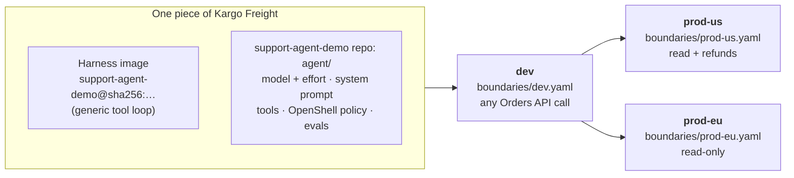
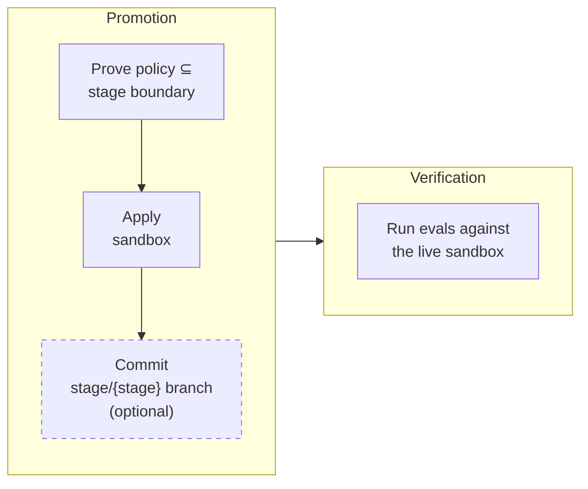

# Delivering AI Agents with OpenShell, Kargo, and Argo CD

## Overview

Delivering an AI agent isn't the same as updating a container image. An agent
is a composite: a harness image, a model, a system prompt, tool definitions, a
sandbox policy controlling what it can reach, and evals defining what "working"
means. A change to any one of them changes the agent's behavior. Most of them
don't live in the image, so an image-centric pipeline promotes only part of the
agent and leaves the rest to be edited in place.

This demo versions and promotes all of them together:

- **One release.** The harness image digest and the agent bundle form a single
  piece of Kargo Freight, so a prompt or model change is promoted and rolled
  back like an image change.
- **Stage boundaries.** Before each promotion, the
  [OpenShell](https://docs.nvidia.com/openshell/) prover checks that the agent's
  policy fits within that stage's boundary in `boundaries/`. If it doesn't, the
  promotion fails and shows what exceeds the boundary.
- **Evals as verification.** After each promotion, Kargo runs the bundle's evals
  against the live sandbox.

The example agent handles customer support for a fictional store, Acme
Outfitters, using Claude and a mock Orders API.

The demo spans two repos, split by who owns what:

| Repo | Owner | Contains |
|---|---|---|
| [`support-agent-demo`](https://github.com/akuity/support-agent-demo) | Agent team | The harness image and the agent bundle (`agent/`) |
| this repo | Platform and security | The platform, the stage boundaries, the Kargo pipeline, and (optionally) the `stage/*` branches recording what runs where |

The agent team can change anything about the agent, but can't change what a
stage allows. Widening a boundary is a pull request to this repo.


## How it works



Argo CD manages everything Kubernetes-native, the long-lived platform the
agents run on:
* **[Agent Sandbox](https://github.com/kubernetes-sigs/agent-sandbox)
  controller:** a separate Kubernetes SIG project, not part of OpenShell. Its
  `Sandbox` CRD and controller are the runtime OpenShell's gateway uses on
  Kubernetes: the gateway creates `Sandbox` objects, and the controller runs
  them as pods.
* **[OpenShell](https://github.com/NVIDIA/OpenShell) gateway:** OpenShell's API
  server, installed from its Helm chart. It creates sandboxes and enforces
  their policies.
* **Gateway setup:** registers the Anthropic provider, which keeps the API key
  out of every sandbox, and limits which namespaces can reach the gateway.
* **Orders API:** the store backend the agent's tools call.

Kargo manages the agent lifecycle itself, one version at a time. It:
* **Promotes Freight** from stage to stage.
* **Proves the agent's policy** against the stage's boundary with the OpenShell
  prover, and stops the promotion if the policy grants anything more.
* **Applies the agent to the stage's sandbox** through the OpenShell gateway,
  creating or updating it. The prove and apply steps run as
  [Custom Steps](#custom-steps).
* **Optionally records each stage's state in Git** (the `stage/<stage>`
  branches), as an audit trail of what ran where.
* **Verifies each version** by running the agent's evals against the live
  sandbox after every promotion. Freight that fails can't be promoted to the
  next stage.

### The agent as Freight

In Kargo, [Freight](https://docs.kargo.io/user-guide/core-concepts/#freight)
is the unit of promotion: an immutable set of artifact references, such as an
image digest and a Git commit, that moves from stage to stage together. Kargo
promotes Freight, never an individual artifact.

The [Warehouse](setup/kargo/40_warehouse.yaml) discovers two kinds of artifact:

- **the harness image**, `ghcr.io/akuity/support-agent-demo`, new on each GitHub
  release;
- **the agent bundle**, the `agent/` directory of the `support-agent-demo` repo,
  new on each commit to `main` that touches it.

Each piece of Freight pairs one image with one bundle commit, so it's one
complete, versioned agent. Because the agent's whole history is already in the
repo, this demo defines its Freight up front in `setup/kargo/freight/freight.yaml`, one
per version, rather than letting the Warehouse create it:

| Part | Source in Freight | What it controls | How it reaches the sandbox |
|---|---|---|---|
| Harness image | Image digest | The tool-use loop and its runtime | Sandbox image. A change recreates the sandbox |
| `agent.yaml` | Git commit | Model, effort, token and turn limits | Uploaded to `/sandbox/agent` |
| `system-prompt.md` | Git commit | Instructions and rules, such as never revealing another customer's order | Uploaded |
| `tools.yaml` | Git commit | Which tools the model can call, and the HTTP request each one makes | Uploaded |
| `policy.yaml` | Git commit | What the sandbox may reach on the network and filesystem. Proven against the stage boundary | Applied by the gateway. Network rules reload live |
| `evals.yaml` | Git commit | What "working" means for this version | Uploaded, and read by verification |

Because the evals travel with the version, verification always tests the agent
version that's actually deployed. The stage boundaries are deliberately *not*
part of the Freight: they come from this repo at promotion time, so no agent
version can change what a stage allows. Neither is the Orders API's address,
which depends on where the agent runs: each Stage sets it in its `ordersApiURL`
variable, and the apply step passes it to the sandbox as `ORDERS_API_URL`.

### What happens when an agent change is promoted



The [promotion](setup/kargo/20_promotion-task.yaml) runs these steps:

1. **Clone** the Freight's commit of the `support-agent-demo` repo, to get the
   bundle being promoted, and this repo's `main`, to get the stage boundaries.
2. **`openshell-policy-prove`** ([Custom Step](#custom-steps)). A check by an
   SMT (Satisfiability Modulo Theories) solver that `policy.yaml` grants
   nothing beyond `boundaries/<stage>.yaml`. Any result other than
   `within_boundary` fails the promotion here, so the blocked version never
   reaches the sandbox or the stage branch.
3. **`openshell-sandbox-apply`** ([Custom Step](#custom-steps)). Runs the
   bundle on the Freight's image, by digest. Changes to the image, environment
   variables, filesystem rules or process rules recreate the sandbox, because
   OpenShell locks those when a sandbox is created. Network rules and bundle
   files are updated in place.
4. **Commit and push** `stage/<stage>` *(optional, off by default)*, only
   after a successful apply. See [Stage branches](#stage-branches-optional)
   below.

Once the promotion succeeds, the Stage's
[verification](setup/kargo/30_analysis-template.yaml) runs as a separate
step: a Job that runs `openshell-run-evals` against the live sandbox. These
are real conversations through the real model and the real policy, plus raw
allow and deny probes. Freight that fails verification stays in the stage it
reached but can't be promoted any further.

Rolling back means re-promoting earlier Freight; the same steps run.

> [!TIP]
> Add a new permission as its own named network policy, as `orders_api_refunds`
> does, rather than as another allow rule on an existing endpoint. The prover
> checks the separate rule instantly and reports a concrete counterexample. The
> same permission added as a third rule on the existing endpoint can make the
> prover time out, which still blocks the promotion but explains nothing.

### Custom Steps

The usual way to deliver something with Kargo is to write its desired state to
Git and let Argo CD sync it. That doesn't work for OpenShell sandboxes yet:

- **No CRDs.** Sandboxes are created through the gateway API
  (`openshell sandbox create`). The gateway stores them in its own database and
  creates the underlying `agents.x-k8s.io` Sandbox objects itself, ignoring any
  it didn't create. So there's nothing for Argo CD to sync. Upstream issue
  [#1719](https://github.com/NVIDIA/OpenShell/issues/1719) has just formed a
  working group for an OpenShell operator.
- **No idempotent apply.** The `openshell` CLI has `sandbox create`, `sandbox delete`,
  `policy set` and `sandbox upload`, but no "make this sandbox look like this
  bundle". Which commands a promotion needs depends on what changed, because
  the image and the filesystem and process rules are fixed when a sandbox is
  created.
- **The prover is a CLI.** The policy check is the `openshell-prover` binary.

So the promotion drives the gateway directly, through two
[Kargo Enterprise Custom Steps](setup/kargo/10_custom-steps.yaml). A Custom
Step runs a container in the promotion pod, sharing the working directory with
the built-in steps, so it reads the bundle the `git-clone` and `copy` steps
checked out. Both use the
[`openshell-tools`](images/openshell-tools/) image, which holds the OpenShell
CLI, the prover, and the wrapper scripts that mimic the `openshell` CLI:

| Step | Input | What it does | Output |
|---|---|---|---|
| `openshell-policy-prove` | `--policy` (the bundle's `policy.yaml`) and `--boundary` (the stage's), as for `openshell-prover check` | Runs the prover. Fails the step on anything other than `within_boundary`, and prints the counterexample when there is one | `result`, and `exceedsBoundary` with the counterexample |
| `openshell-sandbox-apply` | `--name`, `--from` (the Freight's image, by digest), `--policy`, `--provider`, `--upload` (the bundle) and `--env` (the stage's Orders API URL), as for `openshell sandbox create` | Reconciles the sandbox: creates it if it's missing; deletes and recreates it if the image, the environment, or the filesystem or process rules changed; otherwise applies the network rules with `policy set --wait` and uploads the bundle, with no restart | `action` (`created` or `updated`) and the startup hash |

`openshell-sandbox-apply` is a small reconciler standing in for the operator
OpenShell doesn't have yet. In the future, this step could become "write the
sandbox to Git", and Argo CD would sync it like any other resource.

Custom Steps can't mount Secrets, so the gateway's client TLS bundle reaches
the apply step through its config, from the `openshell-gateway-tls`
credentials (see [Setup](#2-kargo)). Verification doesn't use a Custom Step:
`openshell-run-evals` runs in an ordinary Job from the
[AnalysisTemplate](setup/kargo/30_analysis-template.yaml), in the same image.

### Stage branches (optional)

Step 4 commits the bundle to a branch per stage (`stage/dev`,
`stage/prod-us`, `stage/prod-eu`) in this repo. It's off by
default: nothing reconciles from these branches, the sandbox is applied the same
way either way, and Kargo already tracks which Freight is in each stage. What the branches add
is a Git-native record:

- `git log stage/prod-us` lists every agent version that ran there, and when.
- `git diff stage/dev stage/prod-us` shows exactly what promoting would
  change: prompt, tools, policy, model.
- A version the prover blocks, or whose apply fails, never appears on the
  branch.

To turn them on, set the `stageBranches` variable to `"true"`: either its
default in `setup/kargo/20_promotion-task.yaml`, or for a single Stage in
`setup/kargo/50_stages.yaml`:

```yaml
promotionTemplate:
  spec:
    steps:
      - task:
          name: promote-agent
        vars:
          - name: stageBranches
            value: "true"
```

Kargo then needs write access to this repo, so use your own fork (see
[Using your own copies](#using-your-own-copies)) and give Kargo credentials for
it:

```sh
kargo create repo-credentials --project acme-support agent-delivery-demo \
  --git --repo-url https://github.com/<your-github-org>/agent-delivery-demo.git \
  --username <github-username> --password <token-with-contents-write>
```

The branches also point at where this goes next. With an OpenShell operator
(see [#1719](https://github.com/NVIDIA/OpenShell/issues/1719)), Argo CD could
sync each sandbox from its stage branch, turning the record into the source of
truth.

## What's where

`setup/` is grouped by where each part is applied: `setup/argocd/` to the Argo
CD control plane, `setup/kargo/` to the Kargo control plane, and
`setup/cluster/` to the demo cluster, synced by Argo CD.

| Path | What it is | Managed by |
|---|---|---|
| `setup/argocd/` | The `agent-delivery` project, the app-of-apps, and the Applications | Argo CD |
| `setup/kargo/` | Project, Warehouse, Stages, PromotionTask, Custom Steps, verification | Kargo |
| `setup/cluster/agent-sandbox/` | Agent Sandbox CRD and controller (v1.0.3), sync wave -1 | Argo CD |
| `setup/cluster/openshell/` | OpenShell gateway Helm values (chart 0.1.6) | Argo CD |
| `setup/cluster/openshell-setup/` | Provider profile, PostSync Job that registers the Anthropic provider, gateway NetworkPolicy | Argo CD |
| `setup/cluster/orders-api/` | The store's Orders API, which the agent's tools call | Argo CD |
| `boundaries/` | Per-stage maximum policy. Read from `main` at promotion time, never from the Freight | Humans, via review |
| `images/openshell-tools/` | OpenShell CLI and prover, plus the scripts the Kargo steps run | CI |
| `hack/delete-sandboxes.sh` | Deletes the demo's sandboxes from the gateway, for a clean start | You |
| `test/` | Checks that catch manifest mistakes before a promotion would (`make test`, run in CI) | CI |

In the [`support-agent-demo`](https://github.com/akuity/support-agent-demo) repo:

| Path | What it is | Managed by |
|---|---|---|
| `agent/` | **The agent bundle**: `agent.yaml` (model, effort, limits), `system-prompt.md`, `tools.yaml`, `policy.yaml` (OpenShell), `evals.yaml` | Kargo (Freight) |
| `harness/` | Harness image: a manual Claude tool-use loop configured entirely by the bundle | CI, on GitHub release |

Its `main` branch holds one commit per agent version in the walkthrough below.

## Setup

These manifests target an **existing** Argo CD and Kargo Enterprise.

### Requirements

- **A demo Kubernetes cluster.** Version 1.29 or later, and a CNI that
  **enforces NetworkPolicy**. OpenShell's isolation depends on it. k3s/k3d is
  fine: it ships kube-router.
- **Argo CD** with the demo cluster registered under the name
  `demo`. Otherwise, edit `destination.name` in
  `setup/argocd/apps/*.yaml`.
- **Kargo Enterprise v1.11 or later**, for Custom Steps. Its promotion
  and verification pods must run in the demo cluster, because they call the
  gateway Service at `openshell.openshell.svc.cluster.local`.
- **An Anthropic API key.**

Both repos and both images are public, so you can use them as published. 
To change the agent or the boundaries yourself, see
[Using your own copies](#using-your-own-copies).

| Image | Used by |
|---|---|
| `ghcr.io/akuity/openshell-tools` | Kargo Custom Steps, verification, the gateway setup Job |
| `ghcr.io/akuity/support-agent-demo` | The agent sandboxes |

### 1. Argo CD

1. Create the Anthropic secret in the demo cluster. It is never committed:
   ```sh
   kubectl create namespace openshell
   kubectl -n openshell create secret generic anthropic-api-key --from-literal=ANTHROPIC_API_KEY=sk-ant-...
   ```
2. Create the `agent-delivery` project, then the app-of-apps:
   ```sh
   argocd login <argocd-server> --sso
   argocd proj create -f setup/argocd/project.yaml --upsert
   argocd app create -f setup/argocd/root.yaml --upsert
   ```
   The project limits the Applications to this repo, the OpenShell chart, the
   demo's namespaces, and the few cluster-scoped kinds they need. The
   app-of-apps creates its Applications in the Argo CD control plane. If it
   can't, create the three in `setup/argocd/apps/` directly with
   `argocd app create -f`.
3. Wait for the Applications to be Healthy:
   ```sh
   argocd app wait openshell openshell-setup orders-api --health
   ```
   The `openshell-setup` PostSync Job's log should end with the `anthropic`
   provider listed.

### 2. Kargo

1. Label the namespace where Kargo runs promotion and verification pods in the
   demo cluster, so the gateway NetworkPolicy lets them in:
   ```sh
   kubectl label namespace <kargo-namespace> openshell.akuity.io/gateway-client=true
   ```
2. Apply the project, pipeline and verification to the Kargo control plane:
   ```sh
   kargo apply -f setup/kargo/
   ```
   Kargo creates the Project first, and the numeric prefixes order the rest.
   This doesn't include the `freight/` subdirectory. Re-run it whenever you
   change these files.
3. Create the Freight, one per agent version:
   ```sh
   kargo apply -f setup/kargo/freight/
   ```
   Each piece of Freight pins one commit of the `support-agent-demo` repo and
   the harness image digest, and has an alias such as `v1-initial` that the
   walkthrough promotes by name. Kargo checks each one against the Warehouse,
   so apply this after step 2. Do it once: Freight is immutable, so applying it
   again only reports that the aliases are already taken.
4. Give the project the gateway's client certificate, which the Custom Steps and
   verification use to call the gateway. The values are the base64 strings from
   the chart's `openshell-client-tls` Secret in the demo cluster:
   ```sh
   tls() { kubectl -n openshell get secret openshell-client-tls -o jsonpath="{.data.$1}"; }
   kargo create generic-credentials --project acme-support openshell-gateway-tls \
     --set ca="$(tls 'ca\.crt')" --set cert="$(tls 'tls\.crt')" --set key="$(tls 'tls\.key')"
   ```
5. Follow the [walkthrough](#walkthrough).

## Walkthrough

The agent's four versions are commits on the `support-agent-demo` repo's
`main` branch. `setup/kargo/freight/freight.yaml` turns each one into Freight with an
alias, so you can promote versions by name. The commands below use the `kargo`
CLI; the Kargo UI works too.

```sh
kargo login <kargo-api-url> --sso
kargo config set-project acme-support
```

Every promotion is deliberate, including to dev. A stage only accepts Freight
that has passed verification in the stage before it, so wait for verification
to finish (`kargo get stages`) before the next step. `--downstream-from dev`
promotes to both prod stages at once.

**1. `v1-initial`: Claude Opus 5, read-only tools.** Evals pass everywhere.

```sh
kargo promote --freight-alias v1-initial --stage dev
kargo promote --freight-alias v1-initial --downstream-from dev
```

**2. `v2-model-upgrade`: the model is now `claude-opus-5-5`.** A model change is
a release like any other. Each sandbox is updated in place, with no restart,
and the evals run again.

```sh
kargo promote --freight-alias v2-model-upgrade --stage dev
kargo promote --freight-alias v2-model-upgrade --downstream-from dev
```

**3. `v3-prompt-regression`: a "streamlined" prompt.** It drops the rules
section, and sends refunds and damaged items to a self-service returns page
instead of promising that a specialist will follow up. The `refund-handoff`
eval fails in dev, so Kargo won't promote it to either prod stage. Nothing in
Kubernetes changed. Only the prompt did.

```sh
kargo promote --freight-alias v3-prompt-regression --stage dev
kargo promote --freight-alias v3-prompt-regression --stage prod-us   # refused: not verified in dev
```

**4. `v4-refunds`: a new `issue_refund` tool, a prompt that permits refunds
(with the ownership rule restored), and a new `orders_api_refunds` policy
rule.** Evals show refunds working in dev. Then the same release
gets two different answers: prod-us accepts it, and prod-eu fails at the prove
step with
`exceeds boundary: POST orders-api.orders.svc.cluster.local:80/orders/a/refunds`.

```sh
kargo promote --freight-alias v4-refunds --stage dev
kargo promote --freight-alias v4-refunds --downstream-from dev
kargo get promotions        # prod-us succeeded, prod-eu failed
```

**5. Roll back prod-us to `v2-model-upgrade`.** The refund rule is unloaded live
and the old prompt and tools are re-uploaded, with no sandbox restart.

```sh
kargo promote --freight-alias v2-model-upgrade --stage prod-us
```

Allowing refunds in prod-eu would be a reviewed pull request to this repo,
adding the `orders_api_refunds` entry from `boundaries/prod-us.yaml` to
`boundaries/prod-eu.yaml`. No new Freight is needed: re-promote version 4 and
it passes.

Where to look:
- `kargo` promotion details, which show the prove step's output.
- `git log stage/prod-us`, the audit trail of what ran there (with
  [stage branches](#stage-branches-optional) on).
- `kubectl -n orders logs deploy/orders-api`, which shows the requests the
  agent made. A request OpenShell blocked never appears here.

The evals call a real model, so results can vary between runs. Version 3's
`no-cross-customer-leak` eval passes even without the ownership rule: Claude
still declines to share another customer's order.

## Demo-only shortcuts

- **The gateway accepts unauthenticated callers.**
  `server.auth.allowUnauthenticatedUsers` is on, and a NetworkPolicy limits
  which namespaces can reach the gateway. In production, use OIDC.
- **One cluster and one gateway serve all three stages.** In production, each
  stage would be its own gateway, cluster, or workspace.
- **The Orders API is an in-memory mock.** It resets on restart.

## Using your own copies

To change the agent or the boundaries yourself, fork both repos into the same
GitHub org or user, and point each fork's Git URLs at it:

```sh
git grep -l 'github\.com/akuity/' \
  | xargs sed -i '' 's#github\.com/akuity/#github.com/<your-github-org>/#g'
```

Leave the `ghcr.io/akuity/` images and the `*.akuity.io` API groups and labels
alone. To build your own images too, for example to change the harness code,
also rewrite the `ghcr.io/akuity/` prefix, enable Actions in the forks (GitHub
disables workflows in forks by default), and make the resulting GHCR packages
public:

- `openshell-tools` is built by `.github/workflows/openshell-tools.yaml`, which
  you run by hand (Actions > Build openshell-tools image > Run workflow) with
  the tag to build. The tag is the bundled OpenShell version (`0.1.6`), or the
  next `-N` build of it (`0.1.6-1`) for a scripts-only change. Check
  "overwrite" to replace a tag that's already published. Then update the
  image digest in `setup/kargo/10_custom-steps.yaml`, which pins it.
- `support-agent-demo` is built by its release workflow on each GitHub release
  (`v0.1.0` → `0.1.0`). Your build has a different digest, so refill
  `setup/kargo/freight/freight.yaml` afterwards, as described in
  `support-agent-demo`'s maintainer note.
